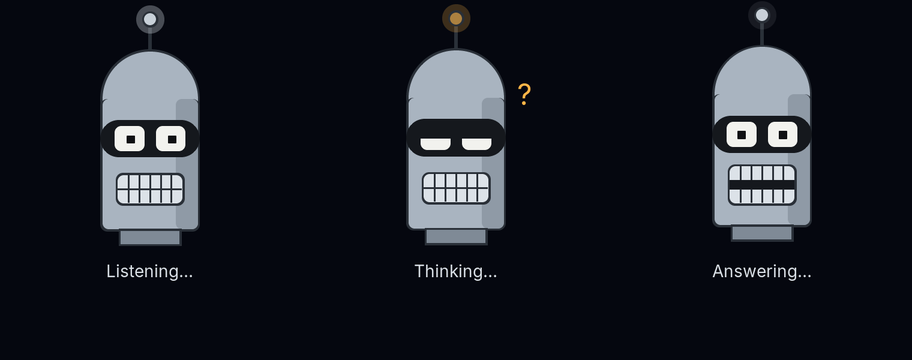

# Assist screens from data files

Design reference for Assist screens described by data instead of compiled
into the firmware, and for the Assist Screen Lab that develops and checks
them on a desktop. Status: prototype on `claude/project-thread-ydiabz`. Every
panel with Assist (a speaker board) compiles the engine
(`HOMETILES_ASSIST_DATA_SCREENS`, `assist_data_screens.h`): Atom, Reactor, Dot
Halo and Voice Pills stay C++, while Sentinel, Phosphor, Light Disc, Lens and
Iris exist only as screen files built into the firmware
(`assist_style_catalog::kFileStyles`). Panels without Assist are unchanged.
Not yet measured on panel hardware.

| Part | Where |
| --- | --- |
| File format reference | `tools/assist-screen-lab/FORMAT.md` |
| Engine (compile, frame, redraw, draw) | `src/ui/assist/assist_screen.*` |
| Screen files, one per built-in style, plus examples (robot, retro_robot) | `tools/assist-screen-lab/screens/*.json` |
| Built-in copies for the firmware (generated) | `src/ui/assist/assist_screen_files.h`, `tools/generate-assist-screens.mjs` |
| Overlay integration | `src/ui/assist/assist_overlay.cpp` |
| Desktop lab (window and headless) | `tools/assist-screen-lab/lab.cpp`, `build.mjs`, `README.md` |
| Host tests | `tools/tests/assist/test-assist-screen-files.mjs`, `test-assist-screen-render.mjs` |
| Built-in styles it reproduces | `src/ui/assist/assist_styles*.cpp`, `assist_style_catalog.h` |

## Why

The Assist overlay offers nine styles (Atom, Reactor, Dot Halo, Voice Pills,
Sentinel, Phosphor, Light Disc, Lens, Iris), each hand-written C++ against
LVGL. A new style or a tweak needs a firmware build and an OTA update. A data
file can instead be added, shared and changed without firmware.

The goal is files that look like the built-in styles, cost about the same on
the panel, and cannot hang or crash the panel however they are written,
because a file may come from a download. The first two are shown on the
desktop; the panel cost still needs measuring (below).

## How a screen runs

A file is a JSON object with colours, named values (vars), optional layouts
per screen shape, and a list of shapes (items) whose properties are small
formulas. The engine works in three steps.

1. **Load (once per showing).** A bounded JSON parser builds a fixed DOM over
   the file text. Every formula is compiled (Pratt parser) to a small
   stack-machine program in one fixed code array. Names resolve to slots:
   built-in inputs, vars, per-element lets and repeat indexes; a name means
   one thing (a var, a let or a colour, never two). The engine counts the
   worst case per frame over every branch and repeat (repeat counts are
   constants), weighing transcendental functions more than arithmetic, and
   refuses the file if it is over any limit, with a message naming the
   problem and its line.
2. **Frame (every 33 ms).** The host sets the inputs, the engine steps the
   vars in order (a state var may keep a short history, read with `prev()`),
   then runs each element's formulas for each repeat into a flat draw list:
   lines (also dashed), arcs and rings, discs (optionally with a vertical
   gradient), filled and outlined rectangles, polylines with fading trail
   copies, text and scrolling text rows. Each shape is charged its estimated
   painted area; past the budget shapes are left out and counted.
   Coordinates are clamped and snapped to half pixels, so movement too small
   to see draws the same list.
3. **Redraw and draw.** Each top-level element keeps a hash of its commands
   and the box it covered this frame and the frame before. Only the boxes of
   elements whose drawing changed are invalidated (joined, at most 8 areas); a
   frame with no visible change invalidates nothing. LVGL renders the screen
   in bands and calls the painter once per band; `draw()` skips regions and
   commands whose box misses the band and replays the rest with
   `lv_draw_line/arc/rect/label`, the calls the line styles already use.

The inputs are what the overlay already feeds the built-in styles
(`assist_styles::Frame`):

| Name | Value |
| --- | --- |
| `t`, `dt`, `frame` | Seconds since the screen opened, seconds since the last frame, frame number |
| `level` | Voice (listening) or answer (answering) loudness, 0..1, eased by the overlay |
| `mode` | 0 for the listening look up to 1 for the thinking/answering look, eased |
| `answering` | 1 while the answer plays |
| `r` | Base radius; it pops in from 0 as the screen opens |
| `cx`, `cy`, `w`, `h` | Centre and screen size |
| `wide`, `square`, `tall` | 1 for the screen's shape |

Animation is maths, not keyframes: `sin(t * 2)` pulses, `x + (target - x) *
0.12` eases, a state var with `every: 0.7` and `rand()` jumps every 0.7 s, and
`mode` cross-fades the listening and thinking looks. State vars (`init`,
`next`) carry anything that must remember; `keep` and `prev(var, k)` give a
short list (Light Disc's trail corners).

## Safety: why a file cannot hang or crash the panel

Every structural limit is checked at load (`assist_screen.h`, table in
`FORMAT.md`): file size 24 KB, JSON values and nesting, compiled code 4096
steps, 192 names, 160 elements, repeat 256, groups 4 deep, polylines and their
point pool, 16 history vars, 24 text buffers of 48 bytes, at most 1,200 shapes
and 60,000 weighted formula steps per frame in the worst case.

A shape count alone does not bound drawing: one disc can cover the screen. So
every frame also has a fill budget of 6 screens' worth of painted pixels,
estimated per shape from its size clipped to the screen (a line's length times
its width, a disc's area, an arc's length times its width, glows included);
radii are clamped to the screen diagonal. A test file of 1,024 full-screen
translucent discs took 376 ms per frame on a desktop before the budget; now a
frame stops after six of them.

One `Screen` is a fixed block of about 108 KB (PSRAM on the panel; the JSON
DOM, needed only while loading, shares memory with the per-frame draw list),
allocated once. The engine allocates nothing per load or frame; the LVGL draw
calls allocate their draw tasks like any widget's. NaN and infinity become 0,
formula values become integers only through a clamping conversion, and box
edges are clamped before they become pixels. A file can only describe shapes:
no loops of variable length, no user functions, no access to Home Assistant
data, touch or storage, only the font sizes every panel carries. Unknown keys,
unknown shapes, name clashes and layouts that change state vars are refused
instead of guessed.

The host test runs a few thousand mutated copies of the nine files (truncated,
bytes flipped, tokens inserted, numbers swapped for extremes) through frames
at three sizes under AddressSanitizer and UndefinedBehaviorSanitizer. It found
two integer overflows, now fixed.

## Words in files

Files carry readout glyphs and units, never words for people: each fixed text
part is at most 8 bytes (`PK`, `CH1`, `V`, `T+`). The "Listening..." line is
drawn by the overlay from the central translations (`tr().assist_*`), and
Settings shows the built-in styles' translated names for the nine built-in
ids. A file's `name` is only for a new id, like a tile title.

## Format versions

`format` is 1. Additions raise the number; a panel refuses a file with a
higher number than it reads, with a message naming both, so a gallery can
offer each panel only what it reads. Unknown keys are refused (safety), so a
new key always comes with a new format number. Until format 1 ships it may
still change: the review renamed `frame` to `outline` and the text keys to
`box_width` and `frames` while nothing depended on them.

## Screen shapes and layouts

Readouts with a fixed pixel size beside the rings fit a wide screen and
collide with the rings on a narrow one. The engine classifies the screen like
`assist_style_catalog` does (`kWideAspect` 1.2): `wide` (at least 1.2 times as
wide as tall: 1024x600, 800x480, 1280x800), `tall` (480x800, 720x1280) or
`square` (720x720, 480x480).

A file may add `"layouts": {"tall": {...}, "square": {...}}`. Per shape it can
replace `reach` keys (how far the screen reaches sideways, above and below,
which sets `r`, and where the label sits) and give derived vars another
formula; elements can be limited to shapes with `"on": ["wide"]`. Positions a
layout may move therefore live in vars. `assist_screen::baseRadius(reach, w,
h)` is the one radius formula; the built-in styles call it with their own
reach.

Sentinel keeps its side readouts on wide screens, puts them above and below
the rings on tall ones and in the top corners on square ones; Phosphor narrows
its scope on tall and square screens instead of shrinking. Both therefore drop
the built-in styles' `needs: wide`.

## The screen files

All nine built-in styles are files. The render test compares Atom, Reactor,
Dot Halo and Voice Pills with their C++ styles at 1024x600, 800x480, 480x480
and 720x1280: at most 6 % of the pixels differ. The five file-only styles and
the examples are compared with reference pictures
(`tools/tests/assist/fixtures/assist-screens`, made with `--update` from
renders that matched the former C++ styles within 6 %, Sentinel and Phosphor
on wide sizes, since their layouts differ on purpose elsewhere). Worst-case
cost per frame:

| File | Needs | Layouts | Shapes / weighted steps |
| --- | --- | --- | --- |
| `atom.json` | | | 18 / 2,401 |
| `reactor.json` | | | 15 / 1,292 |
| `dot_halo.json` | | | 35 / 5,668 |
| `voice_pills.json` | | | 5 / 887 |
| `sentinel.json` | | tall, square | 144 / 18,303 |
| `phosphor.json` | | tall, square | 299 / 12,625 |
| `light_disc.json` | `tear_free` | | 113 / 4,900 |
| `lens.json` | | | 15 / 1,453 |
| `iris.json` | | | 109 / 9,943 |

Redrawn pixels per frame (the README's table, generated by `lab --table`):
Dot Halo, Lens, Phosphor and Sentinel redraw less than their built-in styles
because only changed elements are invalidated; Atom and Reactor about the
same; Iris (listening, 49k against 27k), Light Disc (answering, 155k against
133k) and Voice Pills (thinking, 38k against 25k) redraw more in one phase.

Known differences: random parts take other random numbers than the built-in
styles (Phosphor's noise, Light Disc's trail turns). Light Disc keeps each
trail's last 9 corners (built-in: 12), so a trail that turns 10 times within
its length is cut short. Circles snap to half pixels where the built-in
objects use whole ones.

## New screens

Two screens show what a file can do beyond the built-in styles. They are
examples for the lab and the microSD card, not built into the firmware.

**Robot** (`robot.json`, 35 shapes / 1,403 steps per frame at most): a small
robot in outline. Listening, it bobs, blinks, its ears glow and sound waves
reach its head with the voice; thinking, its eyes wander, the antenna and
chest light blink amber, a hand goes to its chin and three dots bounce above
it; answering, its mouth moves with the reply, its eyes turn happy and it
waves.


**Retro Robot** (`retro_robot.json`, 34 shapes / 1,630 steps): a tall tin-can
head with a dome, an antenna, a wide visor and a grille mouth. Listening, its
eyes glance about and the antenna ball glows with the voice; thinking, its
lids droop, its eyes roll up and a question mark bobs beside it; answering,
the grille teeth part with each word.



Each is one JSON file of about 6 KB, made in the lab in minutes. A file shows
in place of a built-in style when it is stored as that style's file, for
example `/assist/atom.json` on the microSD card, or comes from Home Assistant
(below).

## On a panel

Every panel with Assist compiles the engine, the nine styles' built-in
files (26 KB, `assist_screen_files.h`) and the overlay path; the C++ code of
the five line styles is gone (-17.8 KB flash, -3 KB RAM).

- Each time the Assist screen opens, the overlay loads, in this order: the
  screen chosen in Home Assistant, `/assist/<id>.json` for the picked style on
  the microSD card (upload it with the Web Admin file manager) or in the
  internal storage, then the built-in copy of the style's file (all nine are
  built in since the 7B showed the engine drawing about twice as many pixels
  per millisecond as the C++ styles' LVGL objects). Atom, Reactor, Dot Halo
  and Voice Pills draw their C++ style only when no file loads. The load time
  and the file's worst-case cost are logged.
- A refused file falls back to the C++ style, Atom for a file-only one, and
  logs the reason (`[Assist] Screen file <id> (microSD) refused, using the
  built-in style: ...`); the panel never shows a broken screen. A build
  without the engine does not offer the file-only styles.
- The 108 KB block and a 24 KB read buffer come from PSRAM on first use and
  are kept. Frames run in the overlay's LVGL timer like the built-in styles,
  with the same easing, pacing and tear-free rules; the painter is one LVGL
  object whose areas are invalidated from `dirty()`.
- A frame over the fill budget logs once per showing.
- Lines, polylines and arcs are not handed to LVGL's draw tasks but drawn
  straight into the band LVGL is rendering (`src/ui/assist/assist_raster.*`):
  LVGL's software renderer runs masks over a skewed line's or an arc's whole
  bounding box, so a diagonal line costs its box and a thin ring its disc,
  while the rasterizer visits only the pixels along the shape, with coverage
  from the distance to the edge for the anti-aliasing and LVGL's own RGB565
  mixing. This is safe because LVGL's single software draw unit executes
  every earlier draw task before the draw callback goes on, so the direct
  write lands over the right pixels; a threaded LVGL, a second draw unit or
  the PPA unit switch it off at compile time, and a band that is not RGB565,
  byte-swapped RGB565 or XRGB8888 keeps LVGL's path. Dashed lines, discs,
  rectangles and text stay LVGL draw tasks. Only edge pixels differ from
  LVGL's drawing (`test-assist-raster.mjs`, `test-assist-screen-render.mjs`).

## Screens from Home Assistant

Screen files can live in Home Assistant and reach panels through the Bridge,
on the direct link and on MQTT alike (Bridge `assist_screens.py`, firmware
`src/ui/assist/assist_screen_store.*`, contract in
`src/audio/assist_contract.h`):

1. Users put screen files (`*.json`, at most 24 KB) in
   `<config>/hometiles/assist_screens/` and run the
   `tab5_lvgl.reload_assist_screens` service (or restart Home Assistant). The
   Bridge checks size, JSON, `id` (a-z, 0-9, _, never a built-in id) and
   `name`, logs each file it leaves out, and keeps at most 16, sorted by name.
2. Every panel gets `{base}/assist/screens` retained
   (`{"v":1,"screens":[{"id":"robot","name":"Robot"}]}`) and each file
   retained on `{base}/assist/screen/<id>`; unchanged files are not sent again
   and withdrawn ones get an empty retained message.
3. The panel lists the files after its built-in styles: in **Settings ->
   Assist** by their names, and in the Assist status `screen_styles`, so the
   Bridge's Assist screen select offers them. Picking one (on the panel, or
   `screen_style` with the file's id from the select) stores the choice and
   subscribes to that file only.
4. The panel keeps the chosen file in its internal storage (`/assist_ha/`),
   written only when it changed, so it still shows while the Bridge is away.
   The overlay loads it each time the screen opens; a refused file keeps the
   built-in style and reports the reason in the status `screen_error`, which
   the select shows as an attribute and the Bridge logs.

The panel checks every limit itself; the Bridge only filters what it offers.

## Integration contract (for a release)

- Ownership: the overlay owns the `Screen` block and the read buffer for the
  panel's lifetime (PSRAM, about 132 KB together); nothing else uses them.
- Threading: `load()`, `reset()`, `frame()`, `dirty()` and `draw()` run only
  in the LVGL task (the overlay's timer and its painter's draw event), like
  every other UI path; no worker touches the engine.
- Loading: at most 24 KB parsed per showing, to be measured on the S3 and P4.
  Files could be compiled once when uploaded instead.
- Fallback: a missing or refused file always leaves the compiled style, with
  one English log line; the built-in styles stay in the firmware until every
  maintainer board has run the files.
- Flash: the engine and the nine built-in copies (26 KB) are only in builds
  with the define (measured below).

## Measurements

`waveshare_7b` images:

| Build | Image | Static RAM |
| --- | --- | --- |
| All nine styles in C++, no engine | 5,182,768 bytes | 91,064 bytes |
| Engine, nine styles in C++ and nine files built in (former test build) | 5,257,216 bytes | 91,412 bytes |
| Engine, four styles in C++, five file-only styles built in (now) | 5,231,712 bytes | 88,328 bytes |

So the engine with the screen store costs about 49 KB of flash over C++ only,
and saves 2.7 KB of static RAM (the line styles' state); the engine's 108 KB
block comes from PSRAM at runtime. Panels without Assist do not compile it.

### Frame times

The panel measures its own frames (`src/ui/assist/assist_timing.*`): while
the Assist screen shows, every LVGL refresh that drew is one frame with its
draw time (refresh start to ready: rendering plus the copies into the display
memory), the share spent in the flush callback (the copies), the pixels
flushed and whether it ran over the 33 ms frame period; the overlay adds its
own work per timer tick (the engine's frame, the invalidation) and the
interval between ticks. Count, average, maximum and a 1 ms histogram for the
95th percentile are kept per screen id and phase in a 17 KB PSRAM block; the
opening frame (the whole screen) is kept apart. **Web Admin > Settings >
Diagnostics > Assist screen drawing** shows the table (`/api/assist-timing`,
Refresh, Reset); Preview in Settings > Audio plays every phase of a style.

Desktop lab (1024x600, XRGB8888, this computer; the panel's figures are what
count), time per frame of the file with LVGL's draw tasks against the direct
rasterizer, listening / thinking / answering:

| File | LVGL draw tasks | Direct rasterizer | Share |
| --- | --- | --- | --- |
| `iris.json` | 0.69 / 1.38 / 1.26 ms | 0.29 / 0.62 / 0.54 ms | 42-45 % |
| `phosphor.json` | 0.82 / 0.39 / 1.17 ms | 0.44 / 0.25 / 0.57 ms | 49-64 % |
| `reactor.json` | 0.87 / 0.65 / 0.58 ms | 0.52 / 0.42 / 0.47 ms | 60-81 % |
| `sentinel.json` | 0.92 / 0.89 / 0.94 ms | 0.59 / 0.61 / 0.62 ms | 64-69 % |
| `lens.json` | 0.71 / 0.66 / 0.74 ms | 0.51 / 0.46 / 0.52 ms | 70-72 % |
| `atom.json` | 1.16 / 1.29 / 1.30 ms | 1.13 / 0.81 / 1.10 ms | 63-97 % |
| `light_disc.json`, `dot_halo.json`, `voice_pills.json`, the robots | within 10 % (discs, no long lines) | | |

The pictures differ in edge pixels only: at most 1.3 % of a screen's pixels
by the render test's rule, the ring and axis-aligned lines pixel for pixel,
thin diagonal lines slightly crisper (symmetric coverage where LVGL's mask
leans to one side).

Measured on the 7B (Zeid, 2026-10-19/20, Settings > Audio > Preview per
style, tables in `build/perf-logs/panel-*.txt` of the thread's worktree):
before any change every style took 70-120 ms per frame (8-12 frames a
second), the engine's own work 1-4 ms of it, the copies into the display
memory 17-49 ms, and the rest LVGL rendering at about 0.3 ms per 1,000
changed pixels whatever the style drew. The rasterizer alone changed little
on the panel; the cost was the tile grid rendered under the overlay for
every changed pixel (LVGL treats only a screen's children as covers), and
the two copies per frame. With the screen hidden under the overlay, the
reduced pre-swap copy (p4_dsi_camera_presenter) and the rasterizer, draw
time per frame in the listening phase, before -> after:

| Style | Before | After, -Os | After, -O2 |
| --- | --- | --- | --- |
| Phosphor | 73 ms | 30 ms | 25 ms |
| Iris | 74 ms | 36 ms | 29 ms |
| Lens | 52 ms | 36 ms | 31 ms |
| Voice Pills | 38 ms | 22 ms | 23 ms |
| Dot Halo | 66 ms | 42 ms | 40 ms |
| Reactor | 82 ms | 49 ms | 46 ms |
| Sentinel | 72 ms | 53 ms | 45 ms |
| Light Disc | 127 ms | 57 ms | 47 ms |
| Atom | 94 ms | 71 ms | 68 ms |

(Every style measured through its file, all nine built in. -O2 is a
whole-firmware build, `tools/build-firmware-local.sh --optimize -O2
--build-path <own cache>`: 720 KB more flash, 10-20 % faster file styles,
nothing for the copy; left off by decision (Zeid, 2026-10-20), the Tab5 has
no room for it, and the S3 showed no gain earlier.)

Opening a screen fell from about 72 ms to 30-44 ms and the copies to 6-25
ms per frame; the panel renders into the SRAM band (36 lines). Tried and
reverted: a direct disc fill in the rasterizer (Atom 71 -> 82 ms on the
panel although faster on the host: the disc styles are bound by the
panel's blending speed on large translucent halos, about 3-4 million
blended pixels a second however they are issued) and skipping the
post-swap copy by LVGL's refresh areas (stale pixels on the panel, never
reproduced on the host). Still open: direct rendering into the two
framebuffers (no band copy at all); the S3; internal/PSRAM minimum free
while the screen shows.

## What the 7B taught (drawing speed, 2026-10-19/20)

Findings from the measurement rounds on Zeid's Waveshare 7B (1024x600, RGB565,
LVGL 9.6 rendering into a 36-line SRAM band, tear-free double buffering),
kept here because the host told a different story every time:

1. **Measure on the panel, not the host.** The desktop lab (x86, -O1,
   XRGB8888) ranked costs wrongly twice: the direct line/arc rasterizer cut
   host frames by half and moved the panel by 10 % at most; a direct disc
   fill was faster on the host and slower on the panel. Host numbers only
   show what a change does to the engine's own work; the panel's cost is in
   LVGL's per-pixel blending and in memory copies. The diagnostics card
   (`assist_timing.*`) exists so that every change is measured on the panel.
2. **An opaque object on `lv_layer_top()` is not a cover.** LVGL looks for the
   topmost opaque object only among the active screen's children, so the
   whole tile grid was rendered under every changed pixel of the Assist
   overlay, every frame. Hiding the active screen while the overlay shows
   (`coverScreen()` in `assist_overlay.cpp`) was the single largest gain.
   Any future full-screen overlay on the top layer has the same problem.
3. **The tear-free path paid twice per frame.** Each band was copied into
   the hidden framebuffer, and after the swap the frame's rectangles were
   copied again into the other framebuffer. The second copy now happens
   before the swap and only for the pixels this frame did not redraw
   (`rect_subtract.h`, one exact rectangle per LVGL area): an animation
   redraws the same region every frame, so almost nothing is copied. Two
   rules came out of it: never subtract a folded bounding box (it covers
   pixels that were not written), and do not derive the skipped area from
   LVGL's invalid areas (that version left stale pixels on the panel while
   every host model of it was clean; the cause was never found).
4. **The engine is free.** Evaluating a screen file costs 1-4 ms per frame;
   the draw list, hashing and invalidation are not where the time goes.
5. **Blending is the floor.** The 7B blends roughly 3-4 million RGB565
   pixels a second through LVGL whatever issues them. Styles made of large
   translucent halos (Atom's three glows of up to 200 px radius, Reactor,
   Dot Halo) overdraw 1.5-2 times the changed area and stay at 13-20 frames
   a second; styles made of lines and thin arcs (Phosphor, Lens, the
   robots) reach 30. The remaining fixed cost is the band copy (6-25 ms a
   frame), which only direct rendering into the framebuffers removes.
6. **-O2 is worth 10-20 % on the file styles and nothing on the copies**, for
   720 KB of flash; left off (`--optimize` in the build script documents it).
7. **The four C++ styles drew slower than their files** (Atom 207k pixels in
   74 ms against Phosphor's 203k in 30 ms), so all nine styles are files
   now, the C++ kept as the fallback.

## The lab

The lab runs the engine with the firmware's LVGL 9.6 renderer, fonts and the
overlay's frame loop and easing, in a window (SDL2) or headless to PNG files.
It also links the built-in styles, so it can show a file next to the style of
the same id.

### Build

Prerequisites: Node, git, a C/C++ compiler (gcc or clang) with `ar`, and SDL2
for the window. Without SDL2 the lab builds headless only.

- Linux or WSL: `sudo apt install build-essential libsdl2-dev`. Tested on
  WSL2 (Ubuntu 24.04, g++ 13.3, SDL2 2.30, window through WSLg). Use Node 24
  for the repo's tests: Node 26 breaks the web asset check.
- Windows: clang or gcc with `ar` (or `llvm-ar`) on PATH; the window needs
  SDL2 found by `pkg-config`, else the lab builds headless.

```sh
node tools/assist-screen-lab/build.mjs
```

LVGL 9.6.0 is found in this order: `LVGL_INCLUDE`,
`~/Documents/Arduino/lvgl-9.6.0/lvgl` (the Windows firmware build), or a
shallow clone of `v9.6.0` into `build/assist-screen-lab/lvgl-9.6.0`. LVGL and
the fonts are compiled once into a cached archive (`tools/lib/lvgl-host.mjs`,
shared with the host tests). Output: `build/assist-screen-lab/lab`. The build
should print no compiler warnings (the render test checks).

### Run

```sh
build/assist-screen-lab/lab                   # all screens in screens/
build/assist-screen-lab/lab --size=480x800    # start at another panel size
build/assist-screen-lab/lab my-screens/       # another folder, or single files
```

The window has a button bar: one button per screen; Auto, Listening, Thinking,
Answering; Built-in (the compiled style with the same id); Voice (simulated,
or hold the mouse: higher is louder); `<` size `>` through 1024x600, 1280x800,
800x480, 1280x720, 720x720, 480x800 and 720x1280. The numbers row shows
worst-case shapes and steps, pixels redrawn per frame (the panel's main cost),
time per frame on this computer (a rough guide only), the screen's shape and
whether the file has a layout for it, and a warning when the file needs a wide
screen the panel would not offer it on. Keys: arrows or Tab switch screens,
`1` `2` `3` phases, `A` auto, `B` built-in, `V` voice, `[` `]` size, `R`
reload, `S` screenshot, `Esc` quit. Saving a file reloads it.

Headless:

```sh
build/assist-screen-lab/lab tools/assist-screen-lab/screens --png=out --compare --frames [--size=WxH]
build/assist-screen-lab/lab tools/assist-screen-lab/screens --png=out --table
```

The first writes one PNG per screen and phase (the built-in style on the right
with `--compare`) and prints time and redrawn pixels per frame; `--table`
prints the README's results table. Runs repeat exactly: the simulated voice
and LVGL's `lv_rand` start from fixed seeds. `LAB_DIRTY=1` prints every
redraw area.

### Test

```sh
LVGL_INCLUDE=build/assist-screen-lab/lvgl-9.6.0 node tools/run-tests.mjs assist
```

(`LVGL_INCLUDE` only when the lab build cloned LVGL; the tests also look in
`~/Documents/Arduino/lvgl-9.6.0/lvgl`.)

- `test-assist-screen-files.mjs` compiles the engine with ASan/UBSan where the
  compiler has them, loads every file and its built-in copy, runs 400 frames
  through every phase checking the worst case holds, runs the mutation pass,
  and checks refusals (limits, bad formulas, unknown keys, name clashes, bad
  layouts, format versions, long text), history, cost weights, layouts and
  the fill budget against hostile files.
- `test-assist-screen-render.mjs` builds the lab, renders every screen at four
  sizes next to its built-in style, compares the pixels, and checks that a
  second run gives the same pixels.

Both report `SKIP` without LVGL 9.6.0 or a compiler.

## Making or changing a screen

1. Copy the closest file in `screens/`, give it a new `id` and `name`.
2. Run the lab on it; save to reload. Use Built-in to compare with a style.
3. Step through the sizes. Put positions a narrow screen must move into vars
   and give `tall` and `square` layouts where needed.
4. Check the numbers row stays well inside the limits and the redrawn pixels
   stay low: give parts that move independently their own top-level element.
5. Run the tests. For a built-in id, regenerate the firmware copies with
   `node tools/generate-assist-screens.mjs`.

## Toward a release

1. Measure on every maintainer board (above).
2. Done: screens from Home Assistant, listed after the built-in styles.
3. Done: Sentinel, Phosphor, Light Disc, Lens and Iris are file-only. Atom,
   Reactor, Dot Halo and Voice Pills stay C++ (as files they would cost the
   same 7 KB, and the C++ versions stay a fallback that needs no engine).
4. Later: upload screen files in the Web Admin, compiled once when uploaded.

Open questions: where downloadable screens come from (a gallery, the Bridge,
a URL), and whether a panel keeps several files or one active screen.
